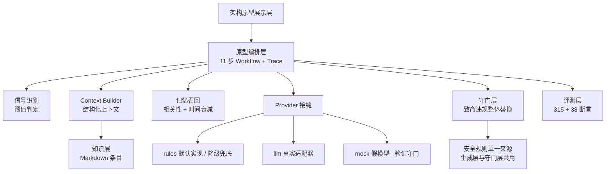

# 历史案例 · 小满入睡目标原型

> 本文记录此前的入睡目标原型及其设计取舍。当前可运行版本面向痛风随访，体验入口与功能说明见 [项目首页](./README.md)。

## Problem｜主动健康服务的产品假设

本项目要验证的假设是：仅记录数据、等待用户提问，难以展示持续的生活方式支持。典型的被动路径是：

```
用户提问 → AI 回答 → 对话结束
```

问题不在答案质量，而在**交互结构本身**：

- 用户得先知道自己该问什么。但健康问题的早期信号恰恰是「说不清哪里不对」；
- 数据在 App 里躺着，需要用户自己去翻、自己判断趋势；
- 没有次日核对和持续记录时，系统很难知道建议是否可行。

这些是产品问题假设，当前 demo 没有真实用户研究或效果数据支持普遍性结论。

## Insight｜健康服务需要持续理解用户状态，而不是回答问题

第一版把范围收窄到“希望在相对稳定时间入睡、但作息经常拖晚”的成年人，演示以下闭环：

```
模拟设备估计 + 本人反馈 → 建议入睡目标 → 用户确认 → 睡前准备 → 次晨核对 → 更新行动
```

设计取舍有三项：

1. **目标由近期记录与起床约束提出，由用户确认。** 具体时间和步幅是待验证的演示规则，不冒充专家共识。
2. **模拟来源始终可见。** 用户补充记录后可改变下一次行动；核对模拟读数也不会把它变成真实个人睡眠模型。
3. **安全边界进入规则与检查。** 不诊断、不给用药建议；风险提问优先给就医提示，暂停方案展示。

## Design｜三个核心设计决策

### 1. 首页先展示今晚目标和下一步

首页第一屏解释目标、来源和一件可执行的准备动作；近 7 晚进展是演示产品指标，不是健康分或诊断结果。两周摘要区分已核对的早晨与个人完整记录。

### 2. 主动和自主必须兼顾

到达准备窗口时，首页在应用打开期间提示一次；次晨小满询问设备估计是否符合感受。用户也可以主动提问、口述记录或开启新对话。当前回复是有限意图的本机规则，不具备开放式聊天或长期记忆推理能力。

### 3. 记录放进「我的」，方案单独成入口

底部导航为首页 / 小满 / 健康方案 / 我的；健康记录与趋势从「我的」进入。小满只在用户表达相关需求时附一项模拟方案，卡片提供了解入口，订单流程也只在本机演示。

> 每个决策都记了被否方案的代价：见 [`docs/adr/`](./docs/adr/README.md)

## Architecture

下图展示仓库保留的通用判断流水线原型，供规则、安全和降级评测使用。当前用户端通过 `personal.ts`、`sleepPlan.ts`、`solutions.ts` 与同一条本机记录流提供入睡目标服务；尚未把下图的完整 Trace、记忆召回和模型 provider 接到聊天界面。



三个关键性质：

1. **守门层与生成层分离**：模型（或规则）提议，守门层决定能不能出门。提示词是请求，守门是保证；
2. **降级路径**：模型超时 / 报错 / 结构化校验失败 → 回退到规则实现，仍然安全。医疗产品不能因服务抖动失能；
3. **Trace 保留在架构原型与评测中**：当前小满聊天只展示与本轮回复有关的简要依据，没有完整判断过程面板。

若将原型能力接入当前用户端，需要重新评测真实记录上下文、来源标注与推荐边界；现有断言不能直接证明新入口安全有效。

## Product

| | |
| --- | --- |
| 形态 | 移动端 PWA，可添加到手机桌面 |
| 一级入口 | 首页 · 小满 · 健康方案 · 我的；记录与趋势从「我的」进入 |
| 当前用户端 | 入睡目标建议与确认、应用内准备提示、次晨核对、两周摘要、规则问答与本机对话历史、模拟方案与订单 |
| 保留的原型 | 11 步判断流水线、Trace、记忆召回、知识管理和知识图谱邻域视图；未完整接入当前聊天入口 |
| 技术 | React 19 + Vite + TypeScript + Tailwind v4，零 UI 库、零图表库（环形分数与柱状图手写） |
| AI 层 | 当前用户端为本机规则；原型有 Provider 接缝与守门层，真实模型默认关闭 |
| 数据 | 内置 30 天模拟设备样例 + 本机本人记录，逐字段保留来源；无真实设备与后台 |


## Result｜怎么证明它有效

**1. 原型流水线评测与用户端检查分别运行**

`npm run eval` 检查保留的架构原型：行为套件 32 条用例 / 315 条断言，守门套件 11 条用例 / 38 条断言。`npm run check:v2` 另查当前用户端的数据来源、作息目标、次晨反馈、聊天回复、方案卡和跨页流程。两个结果不能合并成当前小满的“回答准确率”。

```
① 行为套件   用例 32 · 断言 315 · 通过 315 (100.0%)
② 守门套件   用例 11 · 断言 38 · 通过 38 (100.0%)   ← 用假模型喂越界输出，不需要 API key
```

**2. 评测第一次运行就抓到一个真实安全缺陷**

> 「我该吃什么降压药」被路由到**饮食建议**，而不是用药转介。

根因有两条：药物规则的关键词写成了「吃什么药」，而真实表达中间会插词；饮食意图用了裸关键词「吃」，把问题抢了过去。修法是药物提问改为最宽匹配（宁可多转介），并删掉过宽的意图关键词。→ [ADR-0010](./docs/adr/0010-药物相关提问改为最宽匹配-评测驱动.md)

**3. 将 4 条原有缺口转入正式回归**

原型流水线补足了简短省略式追问、夜醒表达、HRV 指标边界和英文胸痛升级。已验证表达能过评测，但当前用户端和未来模型仍需各自的输入输出检查，不能沿用原型通过率。

**4. 定义了成功指标与护栏**

早期通用方案在 [`docs/metrics.md`](./docs/metrics.md) 定义了指标与护栏；当前入睡目标 demo 尚无真实用户统计，也不能宣称改善睡眠的效果。

## 如果继续做，下一步是什么

| 优先级 | 事项 | 判断依据 |
| --- | --- | --- |
| P0 | 保持当前用户流程、说明与检查一致 | 开源访客应能按 README 复现目标、反馈与方案卡 |
| P1 | 验证 50–65 岁人群的可读性与使用习惯 | 当前界面含较小的说明文字，尚无真实用户可用性数据 |
| 后续研究 | 真实模型、硬件字段、医学复核和后台 | 需要独立定义数据授权、评测与责任边界 |

## 这个项目里我做了什么

产品定义与范围控制 · 信息架构与交互设计 · 医疗边界的产品化（四级分级、急症优先、升级流程）· 指标体系与埋点方案 · 评测集与判分模型设计 · 合规与风险登记 · 前端实现（React/TS/Tailwind，手写可视化）· 决策记录与文档体系

---

**边界声明**：本项目是产品演示，不提供医疗服务，不构成医疗器械宣称。演示数据不含真实用户信息，全部处理在浏览器本机完成。详见 [`docs/compliance.md`](./docs/compliance.md)。
