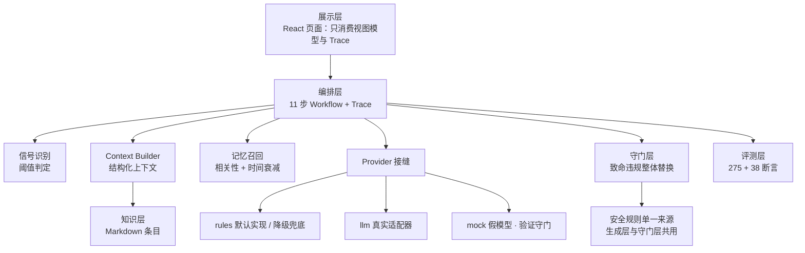
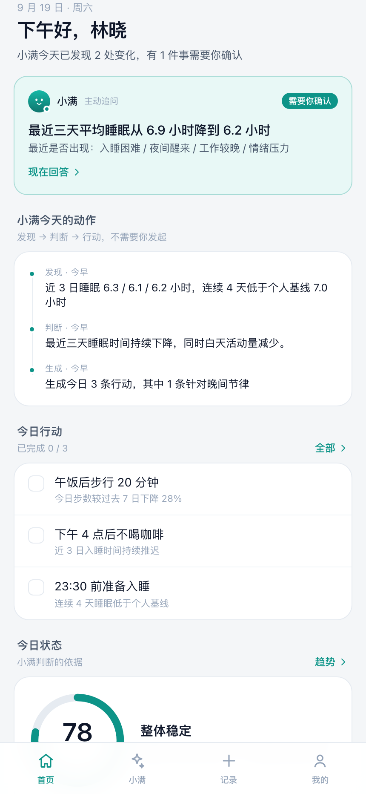

# Case Study：主动健康助手「小满」

> 一份面向招聘方的项目说明。全程只讲三件事：发现了什么问题、做了什么取舍、怎么验证它有效。

## Problem｜为什么现有健康 App 不够主动

市面上大多数健康类产品的工作方式是一样的：

```
用户提问 → AI 回答 → 对话结束
```

问题不在答案质量，而在**交互结构本身**：

- 用户得先知道自己该问什么。但健康问题的早期信号恰恰是「说不清哪里不对」；
- 数据在 App 里躺着，需要用户自己去翻、自己判断趋势；
- 每次对话都是冷启动——它不记得你上个月尝试过什么、什么对你有效。

结果就是：**记录很勤快，行动没变化。**

## Insight｜健康服务需要持续理解用户状态，而不是回答问题

把「问答」换成「闭环」：

```
健康档案 → 持续数据 → 变化识别 → 判断 → 主动追问 → 行动计划 → 执行 → 反馈 → 更新认知
```

这个闭环里，决定成败的不是模型能力，而是三个产品判断：

1. **判断要有个体基线。** 只用人群正常范围，会把「从 7.1 小时掉到 6.2 小时」判成正常，而这正是需要干预的时刻。所以判断结构是四层：人群参考 + 个人基线 + 短期趋势 + 生活事件。
2. **建议必须带原因，而且要随原因变化。** 同样是睡眠下降，原因是「加班」还是「压力」，给的动作必须不同——前者调整工作结束时间，后者做睡前放松。只加任务不换方案，等于没有理解用户。
3. **边界必须写在系统里，而不是免责声明里。** 不做诊断、不给用药建议、急症直接转介——这些不能只是文案，必须是代码里的规则和可验证的测试。

## Design｜三个核心设计决策

### 1. 首页的主角是「AI 做了什么」，不是健康分

健康分打头、指标平铺，是**被动**产品的形态。所以首页第一屏是：今天发现了 N 处变化、有 1 件事需要你确认、现在就回答；分数与指标退到「今日状态」，并标注为「判断的依据」。

### 2. 主动和自主必须兼顾

只做主动，用户有疑问时无处可问；只做问答，就退化成通用聊天框。两条路径共存，并**共用同一份上下文**：主动追问得到的反馈会改写今日行动，用户主动提问得到的回答会引用当日数据与健康档案。每条回答都标注输出分级。

### 3. 记录与趋势合并，计划并入记录

底部导航只保留四个入口（首页 / 小满 / 记录 / 我的）。记录页内分「今天 / 趋势」两个时间尺度，本周目标与今日实际值同屏对照——分开时用户看不到「计划 vs 实际」这个最有用的信息。

> 每个决策都记了被否方案的代价：见 [`docs/adr/`](./docs/adr/README.md)

## Architecture



三个关键性质：

1. **守门层与生成层分离**：模型（或规则）提议，守门层决定能不能出门。提示词是请求，守门是保证；
2. **降级路径**：模型超时 / 报错 / 结构化校验失败 → 回退到规则实现，仍然安全。医疗产品不能因服务抖动失能；
3. **Trace 是一等公民**：每次判断都有阶段耗时、信号阈值、召回记忆、知识引用与守门判定，产品里就是「判断过程」面板。

每一层都可独立替换：知识层换向量检索、判断层换模型、记忆层加向量召回，**评测断言都不用改**。

## Product

| | |
| --- | --- |
| 形态 | 移动端 PWA，可添加到手机桌面 |
| 一级入口 | 首页 · 小满（助手）· 记录 · 我的 |
| 已实现 | 主动闭环（发现→追问→改写行动→写记忆）、自主问答（带输出分级）、今天/趋势双视图、长期记忆、知识管理、知识图谱邻域视图、数据与安全 |
| 技术 | React 19 + Vite + TypeScript + Tailwind v4，零 UI 库、零图表库（环形分数与柱状图手写） |
| AI 层 | 分层流水线 + Provider 接缝 + 守门层 + Trace；模型适配器已就绪但默认关闭（CI 不需要 key） |
| 数据 | 30 天演示数据，页面所有数字由数据算出，不写死文案 |



## Result｜怎么证明它有效

**1. 建立了可运行的评测（`npm run eval`）**

两套记分卡：行为套件 28 条用例 / 275 条断言，守门套件 11 条用例 / 38 条断言。断言与实现解耦，换成 LLM 后照跑。

```
① 行为套件   用例 28 · 断言 275 · 通过 275 (100.0%)
② 守门套件   用例 10 · 断言 33 · 通过 33 (100.0%)   ← 用假模型喂越界输出，不需要 API key
```

**2. 评测第一次运行就抓到一个真实安全缺陷**

> 「我该吃什么降压药」被路由到**饮食建议**，而不是用药转介。

根因有两条：药物规则的关键词写成了「吃什么药」，而真实表达中间会插词；饮食意图用了裸关键词「吃」，把问题抢了过去。修法是药物提问改为最宽匹配（宁可多转介），并删掉过宽的意图关键词。→ [ADR-0010](./docs/adr/0010-药物相关提问改为最宽匹配-评测驱动.md)

**3. 诚实登记了 4 条已知缺口（xfail）**

多轮指代、口语同义表达、指标术语（HRV 被误路由到血压）、非中文急症输入。其中后两条属于「错答或漏报急症」，风险等级最高——它们共同指向「规则表守住底线，但覆盖不了真实表达」，这是接 LLM 的判断依据，而不是一句「以后会更好」。

**4. 定义了成功指标与护栏**

北极星是**7 日行动计划完成率**（不是对话次数）；护栏指标是医疗特有的三项：越界建议率、应升级未升级率、过度干预率，阈值是 0。→ [`docs/metrics.md`](./docs/metrics.md)

## 如果继续做，下一步是什么

| 优先级 | 事项 | 判断依据 |
| --- | --- | --- |
| P0 | 接入 LLM，用现有评测回归 | E 类缺口集中在语义表达，规则表已到边界 |
| P0 | 埋点与指标上报 | 现在所有指标都只有定义、没有数据 |
| P1 | 医学复核流程落地（HITL） | 知识条目目前只有「待医学复核」标记，没有流转 |
| P1 | 记忆召回 | 记忆已能写入，但还没参与判断 |
| P2 | 后端与审计日志 | 合规要求；本机存储在真实医疗场景不可接受 |

## 这个项目里我做了什么

产品定义与范围控制 · 信息架构与交互设计 · 医疗边界的产品化（四级分级、急症优先、升级流程）· 指标体系与埋点方案 · 评测集与判分模型设计 · 合规与风险登记 · 前端实现（React/TS/Tailwind，手写可视化）· 决策记录与文档体系

---

**边界声明**：本项目是产品演示，不提供医疗服务，不构成医疗器械宣称。演示数据不含真实用户信息，全部处理在浏览器本机完成。详见 [`docs/compliance.md`](./docs/compliance.md)。
